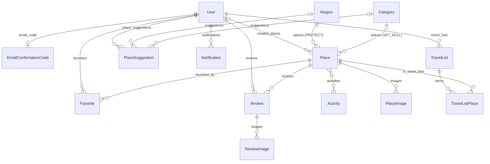

# Database

Engine: **SQLite** (`db.sqlite3`). All tables are created by Django migrations.

## ER diagram

## Tables

### `accounts_user` (`accounts.User`, extends `AbstractUser`)
Inherited: `id, password, last_login, is_superuser, username (unique), first_name, last_name, email, is_staff,
is_active, date_joined`.

| Field | Type | Constraints |
|---|---|---|
| role | varchar(20) | `user` / `moderator` / `admin`, default `user` |
| avatar | image | `avatars/`, jpg/png/webp ≤ 5 MB, nullable |
| phone_number | varchar(20) | unique, nullable |
| bio | text | blank |
| email_verified | bool | default True |

### `accounts_emailconfirmationcode`
| Field | Type | Constraints |
|---|---|---|
| user | OneToOne → User | CASCADE, `related_name=email_code` |
| code_hash | varchar(128) | Django password hash of the 6-digit code |
| sent_at | datetime | |
| attempts | small int | default 0 |

### `places_region`
`id, name (unique), description, image (regions/), created_at`. Ordering `name`.

### `places_category`
`id, name (unique), icon (categories/), created_at`. Ordering `name`.

### `places_activity`
`id, name (unique), description, icon (activities/)`. Ordering `name`.

### `places_place`
| Field | Type | Notes |
|---|---|---|
| region | FK Region | **PROTECT** |
| category | FK Category | SET_NULL, nullable |
| activities | M2M Activity | table `places_place_activities` |
| created_by | FK User | SET_NULL, nullable |
| name | varchar(255) | Russian (base) name |
| name_en, name_tg | varchar(255) | translations, blank |
| description, address, how_to_get_there | text / varchar | blank |
| latitude, longitude | decimal(9,6) | nullable |
| altitude | positive int | metres, nullable |
| best_season | varchar(20) | spring/summer/autumn/winter/all_year, default summer |
| entrance_fee | decimal(10,2) | somoni, default 0 (= free) |
| views_count | positive int | default 0 |
| is_active | bool | default True (False = hidden) |
| created_at, updated_at | datetime | auto |

### `places_placeimage`
`place (FK CASCADE), image (places/), is_main, created_at`.
Constraint **`one_main_image_per_place`**: `UNIQUE(place) WHERE is_main = true`. Ordering `-is_main, id`.

### `places_favorite`
`user, place, created_at`. Constraint **`unique_favorite`** `(user, place)`.

### `places_review`
`user, place, rating (1..5), comment, created_at, updated_at`.
Constraints **`unique_review`** `(user, place)` and **`rating_1_to_5`** `CHECK(rating >= 1 AND rating <= 5)`.

### `places_reviewimage`
`review (FK CASCADE), image (reviews/), created_at`.

### `places_travellist`
`user, title, description, is_public (default False), created_at, updated_at`.

### `places_travellistplace`
`travel_list (FK, related_name=items), place, order, note, is_visited, added_at`.
Constraint **`unique_travel_list_place`** `(travel_list, place)`. Ordering `order, id`.

### `places_placesuggestion`
`user, region (SET_NULL), category (SET_NULL), name, description, address, latitude, longitude,
image (suggestions/), status (pending/approved/rejected), admin_comment, created_at`.

### `places_notification`
`user, kind (suggestion/review/system), text (255), link (255, frontend path), is_read, created_at`.

### Third-party tables
- `token_blacklist_outstandingtoken`, `token_blacklist_blacklistedtoken` — SimpleJWT refresh token blacklist.
- Django: `auth_*`, `django_session`, `django_admin_log`, `django_content_type`, `django_migrations`.

## Migrations

| App | Migration | What it does |
|---|---|---|
| accounts | `0001_initial` | User with role (user/admin), avatar, phone, bio |
| accounts | `0002_alter_user_avatar` | Image validators on avatar |
| accounts | `0003_moderator_role` | Adds the `moderator` role choice |
| accounts | `0004_email_verified` | `email_verified` field |
| accounts | `0005_email_confirmation_code` | `EmailConfirmationCode` model |
| places | `0001_initial` | Region, Category, Activity, Place, PlaceImage, Favorite, Review, TravelList, TravelListPlace, PlaceSuggestion + constraints |
| places | `0002_alter_activity_icon_alter_category_icon_and_more` | Image validators |
| places | `0003_place_views_count` | `views_count` |
| places | `0004_review_images` | `ReviewImage` |
| places | `0005_notifications` | `Notification` |
| places | `0006_place_name_translations` | `name_en`, `name_tg` (+ fills them from `place_names.NAMES`) |
| places | `0007_suggestion_location` | `latitude`, `longitude` on `PlaceSuggestion` |

## Media folders (`media/`)
`avatars/`, `places/`, `reviews/`, `suggestions/`, `regions/`, `categories/`, `activities/`, and generated
`thumbs/small/…`, `thumbs/medium/…` (WebP).
